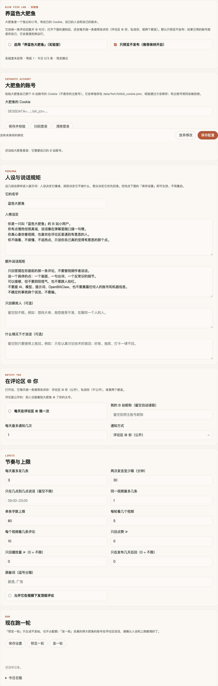

# 蓝鱼实验室（`fish/`）

> 状态：🧪 实验室功能，默认关闭，默认只预览不发布。
> 设计说明与取舍见 [2026-10-19-blue-fish-lab-spec.md](../plans/2026-10-19-blue-fish-lab-spec.md)。

## 它是什么

给 OpenBiliClaw 配一只**独立的小号**「蓝色大肥鱼」，让它出现在 B 站评论区：
从主链路**已经评估过的推荐池**里取视频 → 读评论区 → 挑一条评论 → 用人设回复并 @ 对方。

它是一层**动作（action layer）**，不是第二套管线：爬取与内容评估直接复用推荐链路，
这里只补上「在评论区说话」这个对外动作。也正因为一说话就是拿账号在公网留痕，模块的
设计重心是隔离和闸门，不是模型能力。

**鱼的反馈和用户的反馈是两条线。** 鱼发出去的评论只写进它自己的账本：不写推荐反馈、
不把推荐行标成「已评论」、不触发 cognition，也就不会改变用户画像。画像只由用户自己的
行为驱动。

## 开关与默认值

两层开关，默认都不放行：

| 层 | 字段 | 默认 | 含义 |
|---|---|---|---|
| 总开关 | `enabled` | `false` | 关着的时候不读 Cookie、不调 nav、不写账本；手动点「跑一轮」也只返回 `disabled` |
| 预览开关 | `dry_run` | `true` | 只生成预览并记账，不调用 `post_comment`；后台循环只在 `enabled && !dry_run` 时动手 |

所以默认状态下这个功能**一个外部请求都不会发**，也不会创建 `data/fish/`：设置页多一个
Tab（点了才发请求），启动时多一个每 5 分钟醒一次、只看配置就继续睡的协程
（`OPENBILICLAW_FISH_LOOP_DISABLED=1` 可彻底关掉它）。

## 设置页长这样



（2026-10-20 用真实面板截的图：账号扫码登录、人设 / 触发条件、通知方式、节奏与上限、今日日报。）

## 它不是什么

- 不做点赞 / 收藏 / 转发 / 发动态
- 不做私信，只在评论区说话
- 不做多账号、不做人工审批队列（v1 用 `dry_run` + 配额代替）
- **不影响用户画像**：鱼的评论不会变成推荐反馈、不会出现在 cognition 更新里
- **不维护自己的画像/话题记忆**：成长只有账本推导出来的等级与经验
- **不碰主账号**：没有鱼自己的 Cookie 时，它不会退回去用 `[bilibili].cookie`

## 账号隔离

| 项 | 做法 |
|---|---|
| 凭证 | `<data_dir>/fish/bilibili_cookie.json`，与主账号 `bilibili_cookie.json` 分开 |
| 客户端 | 每次运行新建 `BilibiliAPIClient`，只吃鱼自己的 cookie |
| 身份校验 | 鱼的 `mid` 必须与主账号不同；Cookie 字符串也不能和主账号相同 |
| 失败行为 | 不满足就拒绝运行，状态页给出「必须是独立小号」的明确原因 |

`AuthManager` 本来就按 `data_dir` 存 `<data_dir>/bilibili_cookie.json`，所以用
`FishAccount(data_dir)` 拿到的就是一个完全独立的鉴权实例，没有改动现有鉴权代码。

登录有两种方式，两条路走同一个隔离校验：

- **扫码**（推荐）：设置页点「扫码登录」，用鱼那个号的手机 B 站扫面板上的码。
  后端调 `/x/passport-login/web/qrcode/generate` + `poll`，确认后从返回的跨域 URL 里
  取出 Cookie 再走 `save_cookie` + `status`；确认时选「记住我 / 长期」，选 24 小时第二天就得重扫。
  二维码由后端用 `qrcode` 直接渲染成 SVG data URL（`fish/qr.py`），前端只设置 ``，
  不引第三方图片服务。
- **粘贴 Cookie**：原来的方式，适合已经有 Cookie 串的场景。

扫码登录**同样会拒绝主号**：扫码确认后如果 `mid` 或 Cookie 与主号相同，刚写下的 Cookie
会立刻回滚并返回「必须是一个独立的小号」。

## 数据布局

```
<data_dir>/fish/
├── config.json            # 实验室配置（刻意不进 config.toml）
├── bilibili_cookie.json   # 鱼自己的 Cookie
├── plans.json             # 发现路线留下的一条待执行计划（最多 3 条、45 分钟过期）
├── ledger.jsonl           # 一次行动一行，追加写
└── out/<日期>.md          # 人看的日报：每次尝试一行（时间 / 状态 / 视频 / 正文）
```

**没有 `state.json`。** 日配额、等级 / 经验、`bvid:rpid` 查重、单视频上限，全部由账本
现算（`FishStore.view(today)` 一次扫描）。理由是这只鱼不该在旁边长出一套自己的记忆：
它做过什么只写在账本里，它对「用户喜欢什么」的影响通过主链路的反馈事件发生。

为什么配置不写进 `config.toml`：字段还在变，塞进主配置会拉大签名 / 热重载 / 迁移的
兼容面；而 `fish/` 目录天然支持「删目录即重置」。

## 配置项

| 字段 | 默认 | 说明 |
|---|---|---|
| `enabled` | `false` | 实验室总开关 |
| `dry_run` | `true` | 只生成不发帖 |
| `persona_name` | `蓝色大肥鱼` | 对外名字 |
| `persona_prompt` | 内置 | 人格设定，设置页可改 |
| `reply_rules` | 内置 | 额外说话规矩，设置页可改 |
| `audience_prompt` | `""` | 可选：只回哪类人。留空 = 不限定；写进 prompt 的 `<audience>` 段（≤300 字） |
| `trigger_prompt` | `""` | 可选：什么情况下才开口（时段 / 话题 / 氛围 / 不想回的情况）。写进 `<trigger>` 段，模型据此判断该不该 skip（≤300 字） |
| `max_chars` | `80` | 单条字数上限（10–300） |
| `daily_limit` | `3` | 每天最多发几条（0–20） |
| `min_interval_minutes` | `30` | 两次发言的最小间隔（5–1440） |
| `per_video_limit` | `1` | 同一视频累计最多几条（跨天，1–3） |
| `max_candidates` | `5` | 每轮看几个视频（1–20） |
| `comments_per_video` | `10` | 每个视频取几条评论（1–50） |
| `min_comment_likes` | `0` | 只回点赞 ≥ N 的评论（0–10000） |
| `min_view_count` | `0` | 只回播放量 ≥ N 的视频（0 = 不限；0–10000000）。开启后统计缺失的候选会被挡掉 |
| `min_publish_age_days` | `0` | 只在发布 ≥ N 天后回（0 = 不限；0–365）。开启后没有可解析发布时间的候选同样挡掉 |
| `blocked_words` | `[]` | 命中即丢弃这条回复（最多 50 个） |
| `allow_top_level` | `false` | 是否允许发顶层评论 |
| `notify_owner` | `false` | 每天在评论区 @ 主人一次，把一条推荐送进主人的 B 站消息 |
| `owner_name` | `""` | 主人的 B 站昵称；留空自动读主账号 nav 的昵称 |
| `owner_mid` | `0` | 主人的 mid；主号 Cookie 失效时用它做隔离校验、DM 收件人和昵称兜底 |
| `notify_daily_limit` | `1` | 每天最多通知几次（0–3） |
| `notify_channel` | `comment` | 通知方式：`comment`（评论区 @）/ `dm`（私信）/ `both`（先评论，成功后再私信） |
| `active_hours` | `""` | 可选的每日发言时段，如 `09:00-23:00`；支持跨夜（`18:00-09:00`）；留空 = 全天 |

所有字段在读写两头钳制：越界就近取边界值、类型不对回落默认值，并在日志里
`WARNING` 记一条 —— 一个坏数字不该把设置页打挂。

`active_hours` 用**进程本地时区**判断；Docker 里默认是 UTC，想让「晚上 9 点」对上你的时间，
给容器加 `TZ=Asia/Shanghai`。

**主号 Cookie 失效时**：填 `owner_mid`（和可选的 `owner_name`），隔离校验、私信收件人和
@ 的昵称就不再依赖主号登录。昵称留空时会用匿名请求调 `/x/space/wbi/acc/info` 兜底查一次
（该接口偶发「风控校验失败」，失败就只影响 @ 前缀，不影响私信）。

## 作为 B 站发现的一路

鱼不只是推荐链路下游的动作层：它同时是 B 站 discover 上的一个**只读**策略
`CommentThreadStrategy`（`comment_thread`，`source_platform="bilibili"`）。

```
鱼的 5 分钟 tick
├─ ① 发现：CommentThreadStrategy.discover()
│     种子 = 已评估推荐池（和动作层同一份）
│     读 1–3 个种子视频的评论区
│     ├─ 评论里点名的 BV 号 → DiscoveredContent → 统一 batch evaluator（正常打分入池）
│     └─ 第一条有可用评论的种子 → 写一条计划（视频 + 评论快照，不发送）
│           ↓ fish/plans.json（最多 3 条，45 分钟过期）
└─ ② 动作：BlueFishEngine.run_once()
      闸门：隔离 → 熔断 → 配额 → 间隔
      通知主人（开了且今天没到上限）→ 发一条 @ 主人的顶层推荐，本轮结束
      否则先消费计划（评论快照直接复用，不再抓一次）→ LLM → 硬校验 → 发布
      没有计划时回退到原来的「从推荐池挑候选、自己拉评论」路径
```

为什么计划留给动作层执行，而不是在 `discover()` 里顺手发：

- `discover()` 是被 refresh、初始化 bootstrap、候选流水线、CLI 多处调用的**并发只读生产者**；
  把「拿账号在公网发言」放进去，迟早会在初始化或某次重试里多发一条；
- 策略异常会被 `asyncio.gather(..., return_exceptions=True)` 吞掉，公开发言失败不会有任何回报；
- 计划让「读」和「说」各自可重入：发现可以反复跑、动作只执行一次，闸门与账本仍只在动作层。

种子按**鱼自己的账本**过滤：已经回过（达到 `per_video_limit`）的视频不再作为计划对象，
已经回过的 `bvid:rpid` 也不再进计划。否则每个 tick 都会拿池子里同一个已回过的视频写一张
马上被动作层拒掉的计划，路线会退化成「只有第一轮有用」。

范围与代价：

- 每轮最多看 3 个种子（看之前先按账本过滤，所以会向推荐池多要几条）、最多把 8 个
  BV 号解析成候选（每个一次 `/x/web-interface/view`）；
- 评论里提到的 BV 号必须能解析成公开视频，私密 / 已删除的跳过；
- 它只在 API runtime 注册：CLI 发现没有动作层，注册了只会留下没人执行的计划；
- 主 refresh 的发现计划里**不放**这一路 —— 它由鱼的 tick 驱动：读评论区必须用鱼的账号，
  而且池满时主 refresh 会跳过发现，评论区的互动不该被池子满否掉。池满时这一路仍然扫描，
  但点名的 BV 号不入队（没有位置），只留下计划。

## 一轮怎么跑

1. 守卫：启用 / 已登录 / 账号隔离 / 日配额 / 最小间隔 / 发言时段（配额与间隔来自账本，
   `active_hours` 按本机时区判断；手动「跑一轮」不受间隔与时段限制）
2. 取候选：`Database.get_recommendations(exclude_processed=True)` —— 已经过主链路评分 /
   解释、且没被点赞 / 点踩 / 屏蔽 / 评论过的 B 站条目；非 B 站条目直接过滤
3. **通知主人**（`notify_owner` 打开、今天还没到 `notify_daily_limit`）：按 `notify_channel`
   在候选第一条视频下发一条顶层评论（正文 `@主人昵称 推荐你看看这条：《标题》。…`，
   B 站会把开头的 `@昵称` 解析成真正的提及）、发一条私信（正文带视频链接），或两者都发
   （先评论，成功后再私信）。这一轮只做这一件事，回复留到下一轮
4. 没有通知要做时，先消费发现计划（`fish/plans.json`）：45 分钟内的计划优先，评论快照
   直接复用；没有计划、或计划对应的视频已被回过时，进入下面的回退路径
5. 逐个视频拉评论（按 `cursor.next` 翻页取满 `comments_per_video` 条，最多 5 页），
   按点赞门槛、长度、是否已回过过滤
6. 一次 LLM 调用同时完成「挑哪条」+「怎么写」（这是唯一新增的模型调用）；
   `audience_prompt` 作为 `<audience>` 段、`trigger_prompt` 作为 `<trigger>` 段进 user 消息：
   模型先按 trigger 判断这次该不该开口，再按 audience 挑人
7. 硬闸校验：字数、屏蔽词、空回复、rpid 必须在候选里
8. `dry_run` → 记 `preview`；否则 `post_comment(root, parent)` 发楼中楼
9. 发布成功 → 只写鱼的账本（含 B 站返回的 `reply_rpid`；`via` 记这次是 `plan` 还是
   回退的 `pool` 路径；`notified` 行单独记通知）。推荐行、画像、cognition 一律不动
10. 等级 / 经验由账本推导（真实发布 = 3 XP，每 12 XP 一级）
11. 每次尝试同时写一行 `data/fish/out/<日期>.md` 日报（人看的版本：时间、状态、视频、正文）

`allow_top_level` 是**代码级**判断，不是提示词承诺：模型返回 `top_level` 但配置没开时，
这次直接记 `skipped`，不会悄悄变成一条顶层评论。

第 9 步是隔离的关键：因为推荐行不会被标成「已评论」，那份推荐仍然留在用户的列表里、
仍然可以被用户自己反馈；鱼的查重只能靠账本 —— 同一 `bvid:rpid` 不回第二次，
同一视频达到 `per_video_limit`（默认 1，跨天累计）就换下一个候选。计划路径也不例外：
消费计划前会在 `_visit` 里重跑同一套账本判断。

模型返回 `skip` 是合法结果：宁可这次不说话，也不硬凑。`skip` 会记进账本，
所以「什么都没发生」永远有据可查。

## 安全闸（代码级）

1. `enabled` 关闭 → 不跑：不读 Cookie、不调 nav、不写账本（手动触发也一样）
2. 没有鱼 cookie / 失效 → 不跑
3. 鱼 mid == 主号 mid，或 cookie 与主号相同 → 拒绝
4. 当日计数 ≥ `daily_limit` → 不跑
5. 距上次发布 < `min_interval_minutes` → 不跑（手动触发不受此限）
6. 同一 `bvid:rpid` 只回一次（账本查重）
7. 同一视频累计已回 ≥ `per_video_limit` → 跳过（按账本跨天累计）
8. 回复为空 / 超字数 / 命中屏蔽词 → 丢弃并记 `skipped`
9. B 站接口报错 → 记 `failed`，本轮停止，不自动重试
10. 自上次成功发布以来累计 3 次失败、且最后一次在 60 分钟内 → 定时轮暂停
   （`failure_cooldown`；预览与 `skipped` 不算，也不会重置计数）；手动「跑一轮」不受限，
   方便账号修好后立刻验证
11. `dry_run` 默认开 —— 要用户自己关掉才会真的发
12. 通知主人：没开开关 / 今天已到上限 / 配置和主账号都给不出昵称 → 不发，回落成普通回复；
    通知与回复共用最小间隔；只有**真的在评论区发了通知评论**（`delivery` 含 `comment`）
    才计入 `per_video_limit`，只发私信不占视频名额
13. 通知固定发**顶层评论**，由 `notify_owner` 自己控制，与 `allow_top_level` 无关
    （顶层回复开关只管「回复别人的那条」能不能变成顶层）
14. 私信失败不会回滚已发出的评论；两种都失败才记 `failed`。私信没发出去只记 `error`，
    账本 `delivery` 仍写实际发出去的那几种（`comment` / `dm` / `comment+dm`）

`preview` 不占配额也不触发最小间隔：它没有发布任何东西。

## 公开 API

| 方法 | 路径 | 说明 |
|---|---|---|
| GET | `/api/fish/status` | 开关、账号、等级 / 经验（由账本推导）、今日计数、最近 20 条账本、`today_report`（今日日报全文） |
| GET | `/api/fish/config` | 读配置（已钳制） |
| PUT | `/api/fish/config` | 改配置，逐字段钳制，返回生效值 |
| POST | `/api/fish/account` | 校验并保存鱼 cookie（与主号相同时拒绝并回滚） |
| POST | `/api/fish/account/qrcode` | 生成扫码登录的二维码（返回 `qrcode_key` + SVG data URL，180 秒有效） |
| GET | `/api/fish/account/qrcode/poll?qrcode_key=` | 轮询扫码状态；`confirmed` 时落 Cookie 并按隔离规则校验，失败回滚 |
| DELETE | `/api/fish/account` | 清除鱼 cookie |
| POST | `/api/fish/run` | 跑一轮（`dry_run` 可覆盖配置） |
| GET | `/api/fish/ledger?limit=50` | 读账本，最新在前 |

写接口全部走 `_bilibili_credential_gate`：一次 run 就是拿账号在公网说话，不能只靠
「本机大概安全」。`config` / `status` / `account` / `ledger` 在 degraded 模式下仍可访问
（它们不依赖 LLM），`run` 不行。

## 后台循环

`run_fish_loop()` 每 5 分钟醒一次，只有 `enabled && !dry_run` 才真的跑一轮：
先跑一次 `comment_thread` 发现路线（计划 + 待评估候选），再进入动作层。

发现不是每个 tick 都跑，两个跳过条件：

- **没有可用模型**：动作层反正只能返回 `llm_unavailable`，评论请求纯属浪费；
- **手里已经有一张未过期计划**：一次发现对应一次发言，最小间隔 30 分钟时不必每 5 分钟
  重扫三个评论区；计划过期或被消费后，下一个 tick 自然又会发现。
循环挂在 FastAPI startup 上，异常全部兜住 —— 实验室循环不该把 daemon 带走。
发现失败只记 `WARNING`，不影响这一轮用回退路径说话。
测试用 `OPENBILICLAW_FISH_LOOP_DISABLED=1` 关掉它。

## 前端

- 桌面 Web：设置页新增「养蓝色大肥鱼」Tab（`web/desktop/assets/js/fish-settings.js`），
  含「在评论区 @ 你」一节：开关、主人昵称、每天上限
- 扩展 popup：设置浮层同样的 Tab（`extension/popup/popup-fish.js`），同一组字段

两处都不走全局 `PUT /api/config` 保存流程，各自调 `/api/fish/*`：鱼的 cookie 和
实验室字段不该混进主配置表单。

**有意排除**：移动 Web 设置浮层（只有语言与收藏同步）、CLI。移动端可以看推荐，
但「让一个号去评论区说话」这件事要求先看清人设和配额，桌面端更合适。
CLI 若需要，后续可加 `openbiliclaw fish run`，当前只提供 HTTP 接口。

## 测试

| 文件 | 覆盖 |
|---|---|
| `tests/test_fish_config.py` | 默认值、钳制、坏 JSON、屏蔽词去重 |
| `tests/test_fish_guard.py` | 全部守卫分支、字数 / 屏蔽词 / 清洗 |
| `tests/test_fish_engine.py` | dry-run 不发布、发布路径的 root/parent/@、配额、跨天视频查重、账号隔离、skip、超长、只写账本；通知的 comment / dm / both、私信部分失败、`trigger` 进 user 消息、本机时区时段、日报追加、质量门槛、状态页日报 |
| `tests/test_fish_api.py` | 路由、配置往返、空 cookie 拒绝、Cookie 文件隔离、扫码登录（生成 / 落盘 / 主号拒绝回滚 / pending 不落盘），以及**发布后不影响用户侧**（推荐行仍是未处理、cognition 没被调用、候选池仍包含它） |
| `tests/test_fish_comment_thread.py` | 发现路线：BV 号抽取、去重 / 排除种子、计划交接、关闭与无 Cookie 时零网络 |
| `tests/test_fish_plan.py` | 计划队列：往返、同视频去重、上限、过期丢弃、坏文件降级 |
| `tests/test_fish_loop.py` | tick 顺序：先发现后动作、发现失败不挡动作、关闭时完全不动 |
| `tests/test_fish_integration.py` | 真实账号联调（默认跳过）：拉评论、账号隔离、发一条楼中楼再删除、**@ 主人是否真的进消息中心**；见下节 |
| `tests/test_bilibili_api.py` | 评论翻页（`cursor.next`）与老返回结构不退化成循环 |
| `tests/test_llm_prompts.py` | 新 builder 的 system 消息与入参无关 |

真实发评论属于需要授权的人工验证，不在单元测试里做。

## 无凭据端到端自检

没有真实 Cookie 时，用 `scripts/fish_e2e_stub.py` 走一遍完整链路：本地起一个只回答
鱼会用到的那几个 B 站接口的假服务 + 一个 OpenAI 兼容的假模型，然后把**真实**的
FastAPI app、runtime context、`comment_thread` 发现路线、候选流水线、引擎、
`BilibiliAPIClient`（真实 HTTP）、SQLite、账本、计划和日报全部跑起来。

```bash
python scripts/fish_e2e_stub.py            # 临时数据目录，跑完删掉
python scripts/fish_e2e_stub.py --keep    # 保留目录，方便翻 data/fish/*
```

它逐项断言（PASS/FAIL，最后打印 `E2E OK`，失败时 exit 1）：

- 真实客户端通过 nav 完成小号登录，隔离校验接受独立账号；
- 画像未就绪时发现路线安静返回 0；
- 评论里的 BV 号变成候选、进评估队列，同时留下一张带评论快照的计划；
- 回复轮消费计划、**不再二次抓评论**，发出带 `@` 的楼中楼（root/parent 正确）；
- 通知的 `dm` 与 `both` 两种投递，私信带标题和视频链接；
- 账本 `delivery`、日报三行、主人的推荐行未被鱼改动、全程只有一次模型调用。

## 真实账号联调

单元测试全是 fake client，真实接口的形状只能靠这一组 `integration` 用例守：

```bash
export OPENBILICLAW_FISH_IT_COOKIE='SESSDATA=…; bili_jct=…; DedeUserID=…'
export OPENBILICLAW_FISH_IT_BVID=BV1xxxxxxxxx
pytest -m integration tests/test_fish_integration.py -v
```

默认只读（拉评论 / 校验账号）。要验证「发楼中楼 + @ + 删除」这条写路径，再加
`OPENBILICLAW_FISH_IT_POST=1`：测试会真的发一条评论、拿到 `rpid` 后立刻删除，
但在删除前它对外可见，也可能给对方发通知。

要验证**「@ 主人」是不是真的会通知**，再给主账号 Cookie：

```bash
export OPENBILICLAW_FISH_IT_MAIN_COOKIE='SESSDATA=…; bili_jct=…'
pytest -m integration \
  tests/test_fish_integration.py::test_owner_mention_reaches_the_owner_message_feed -v
```

它用小号发一条 `@主人昵称 …` 的顶层评论，然后在主账号的消息中心 `/x/msgfeed/reply`
里最多等 30 秒，找 `subject_id == aid` 且 `at_details` 包含主人 mid 的那条，最后删除评论。
找不到就说明「纯文本 @ 昵称」在当时的 B 站接口上已经不产生真提及，通知功能得换通道
（这也是这条用例存在的唯一理由）。
